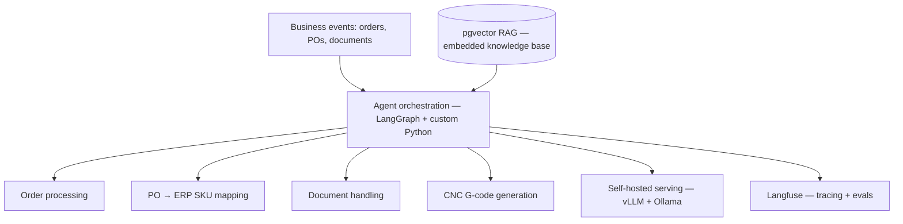
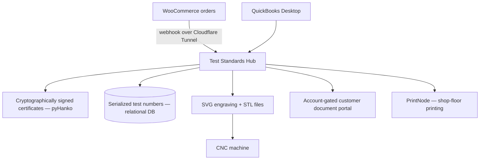
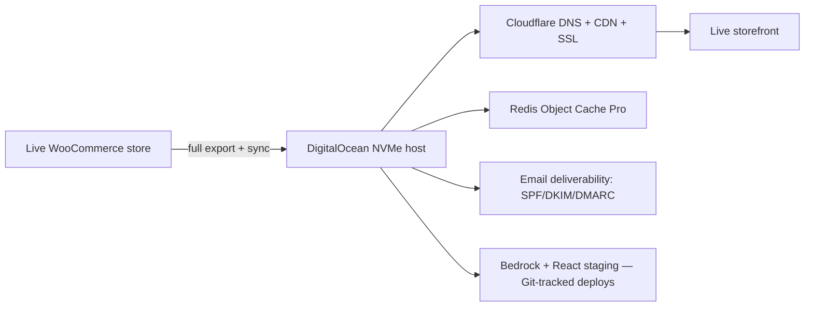
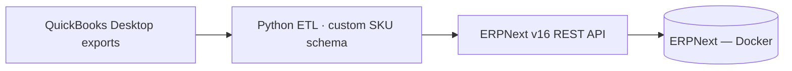
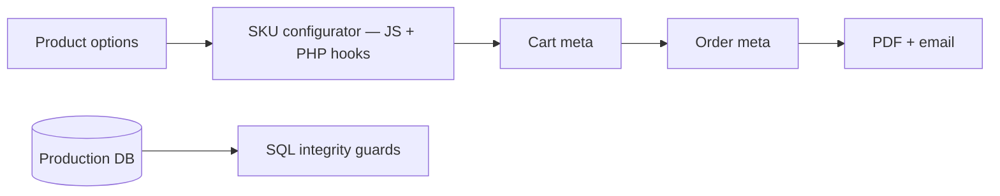

# Work Casebook — Thomas Crowe

Sanitized write-ups of production work I own as **Full-Stack Developer & Technical Operations Lead** at [CalibrationWands.com](https://calibrationwands.com) (a division of Fastec Services LLC). Architecture and outcomes only — no proprietary source, credentials, or internal infrastructure detail.

> **Context.** CalibrationWands.com is a B2B e-commerce manufacturer of NIST-traceable calibration test standards, serving food, pharmaceutical, and textile quality-control customers. I'm responsible for the entire technical stack: storefront, infrastructure, data, ERP, and AI automation.

---

## 1. Self-hosted AI automation — a fleet of production agents

**Problem.** A range of repetitive, judgment-light business operations — reading purchase orders, generating documents, routing orders, preparing machine files — consumed hours of manual work daily and didn't scale.

**Approach.** Designed and deployed six self-hosted AI agents that handle these workflows end to end, built on infrastructure I architect and run myself.

- Six agents orchestrated with **LangGraph** and custom Python, several exposed through Slack (Socket Mode)
- Models served on a self-hosted stack (**vLLM** and **Ollama**) — full control over the models, the data, and pipeline behavior
- Responses grounded in a **pgvector** retrieval pipeline so agents reason over real source documents, not model memory
- Local models fine-tuned with **Unsloth/PyTorch**, training tracked in Weights & Biases; quantization (AWQ/GPTQ) for throughput
- All agent runs traced and evaluated in **Langfuse**

**Stack.** LangGraph · vLLM · Ollama · pgvector · PyTorch · Unsloth · Langfuse · Python · Docker

**Outcome.** Repetitive operations automated on self-hosted infrastructure, keeping sensitive business data in-house and independent of third-party APIs.

> Self-hosted lab; personal and work infrastructure kept strictly separate.

---

## 2. Test Standards Hub — order, certificate & production platform

**Problem.** Orders lived in two disconnected systems (WooCommerce + QuickBooks Desktop). Certificate generation and CNC engraving artwork were manual, and serialized test-standard tracking had no system of record.

**Approach.** Built an internal full-stack platform that becomes the single source of truth and drives production end to end.

- New orders trigger the platform through a **webhook over a Cloudflare Tunnel** — no exposed origin
- Auto-generates calibration certificates with **tamper-evident pyHanko cryptographic signing**
- Embeds a measurement-capture module: per-unit micrometer readings against NIST-traceable references, bringing the workflow into conformance with ISO 10012
- Tracks serialized test numbers for every standard sold, backed by a relational database
- Generates SVG engraving and STL files sent to the CNC machine — a software-to-machine production pipeline
- Triggers **PrintNode** shop-floor printing and serves finished certificates through an account-gated customer portal

**Stack.** React/Vite · Express · Prisma · PostgreSQL · pyHanko · Cloudflare Tunnel · PrintNode · SVG/STL

**Outcome.** One source of truth across two systems; manual certificate, printing, and engraving steps replaced by an automated order-to-manufacturing pipeline. To date the pipeline has produced **3,144 certificates — roughly 260 hours of manual production eliminated** at ~5 minutes each.

---

## 3. Production migration + infrastructure hardening

**Problem.** The production storefront needed a more reliable, performant home, with stronger operational practices around it.

**Approach.** Planned and executed a live cutover to dedicated DigitalOcean NVMe hosting — no data loss, no customer-visible downtime — then hardened the surrounding operations.

- DNS + CDN cutover via Cloudflare; SSL re-issue; recurring outages cut to near zero
- Email deliverability restored (SPF/DKIM/DMARC); Stripe webhooks verified end to end
- Three-tier backup/disaster-recovery (off-site cloud, server-local, provider snapshots) with verified restores
- Database tuning (InnoDB buffer pool, connection limits, timeouts) for production stability
- Currently migrating off a plugin-heavy WordPress setup onto a **Bedrock + React** architecture, rebuilding tooling in-house to eliminate dependency drift

**Stack.** DigitalOcean · Cloudflare · Linux · Redis · Bedrock · React · MySQL

**Outcome.** Faster, reliable hosting; near-zero outages; a safe staging path and verified recovery for ongoing changes.

---

## 4. ERPNext deployment + QuickBooks ETL

**Problem.** Business records lived in QuickBooks Desktop with no modern ERP. A company-wide rollout needed a clean schema and migrated data.

**Approach.** Built and deployed ERPNext v16 (Docker) ahead of the company rollout. Designed a company-wide SKU schema and wrote Python ETL to convert QuickBooks exports into ERPNext over its REST API.

- 4,720 products + 2,852 customers imported via API scripts under a custom company-wide SKU schema

**Stack.** ERPNext · Docker · Python · REST APIs · QuickBooks

**Outcome.** Deployment and data migration built and validated **ahead of company rollout**.

---

## 5. Custom storefront engineering & data integrity

**Problem.** The storefront needed configurable, validated product SKUs across many product lines, and order data needed to stay correct under real load.

**Approach.** Engineered a custom SKU-configurator system and hardened the data layer behind it.

- Dynamic SKU configurator across 10 product lines (JavaScript + PHP WooCommerce hooks) generating valid SKUs in real time, with cart → order-meta → email → PDF integration
- Custom Dompdf invoice/packing-slip templates; validated with Playwright end-to-end tests
- **SQL data recovery & integrity:** recovered 1,534 order records with targeted SQL against the production database, diagnosed the inconsistency at the schema level, and added PHP validation guards to prevent recurrence

**Stack.** JavaScript · PHP · WooCommerce · Dompdf · Playwright · SQL

**Outcome.** Configurable, validated SKUs across the catalog; order data integrity restored and protected at the code level.

---

### Notes

These summaries describe work I performed. Proprietary source code remains private to the company. Diagrams are illustrative, not exact internal topology.
