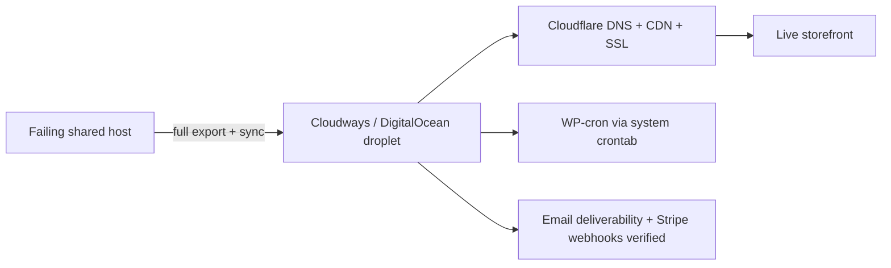
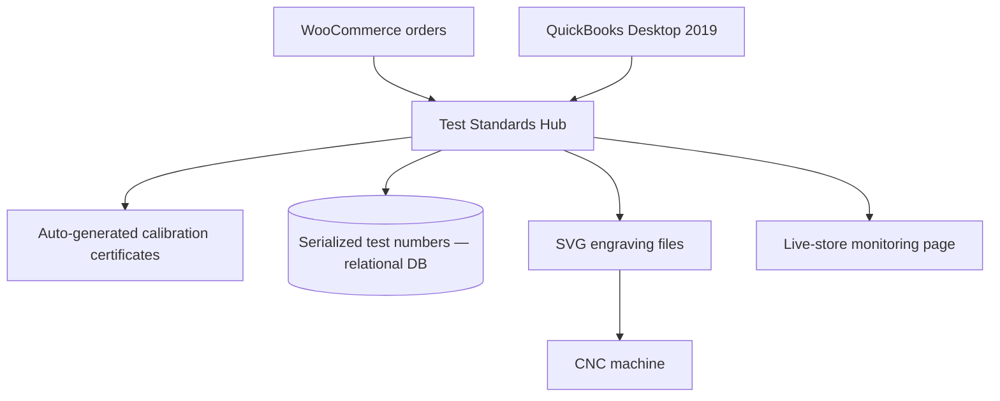
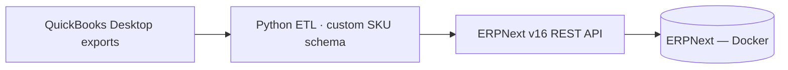

# Work Casebook — Thomas Crowe

Sanitized write-ups of production work I own as **Full-Stack Developer & Technical Operations Lead** at [CalibrationWands.com](https://calibrationwands.com) (Fastec Services LLC). Architecture and outcomes only — no proprietary source, credentials, or internal infrastructure detail.

> **Context.** CalibrationWands.com is a B2B e-commerce manufacturer selling NIST-traceable calibration test standards to food, pharmaceutical, and textile manufacturers. I am the sole technical operator: storefront, servers, data, ERP, and automation.

---

## 1. Zero-downtime migration of a live WooCommerce store

**Problem.** The production storefront ran on a failing shared host. Performance and reliability were degrading while real orders were flowing — I built the business case from documented, outage-driven revenue loss.

**Approach.** Planned and executed a live cutover to a Cloudways-managed DigitalOcean droplet — no data loss, no customer-visible downtime.

- DNS + CDN cutover via Cloudflare; SSL re-issue
- Email deliverability restored; WP-cron moved to system crontab
- Stripe webhook delivery verified end-to-end
- Post-migration credential rotation + 2FA rollout

**Stack.** Cloudways · DigitalOcean · Cloudflare · Linux · crontab · Stripe

**Outcome.** Faster, reliable host; zero data loss; hardened credentials.

---

## 2. Test Standards Hub — order, certificate & production platform

**Problem.** Orders lived in two disconnected systems (WooCommerce + QuickBooks Desktop 2019). Certificate generation and CNC engraving artwork were manual, and serialized test-standard tracking had no system of record.

**Approach.** Built an internal platform that becomes the single source of truth across both systems and drives production end-to-end.

- Unifies order tracking across WooCommerce and QuickBooks in one dashboard
- Auto-generates calibration certificates, routed by which party fulfills the order
- Tracks serialized testing numbers for every test standard sold, backed by a full relational database
- Generates SVG engraving files (size + lot number) sent directly to the CNC machine — a software-to-machine production pipeline
- Custom site-monitoring page for the live store

**Stack.** React/Vite · Express · Prisma · PostgreSQL · Adobe PDF Services · SVG

**Outcome.** One source of truth across two systems; manual certificate and engraving steps replaced by an automated pipeline.

---

## 3. ERPNext deployment + QuickBooks ETL

**Problem.** Business records lived in QuickBooks Desktop with no modern ERP. A company-wide rollout needed a clean schema and migrated data.

**Approach.** Built and deployed ERPNext v16 (Docker) ahead of the company rollout. Designed a company-wide SKU schema and wrote Python ETL to convert QuickBooks exports into ERPNext over its REST API.

- 4,720 products + 2,852 customers imported via API scripts under a custom company-wide SKU schema

**Stack.** ERPNext · Docker · Python · REST APIs · QuickBooks

**Outcome.** Deployment and data migration built and validated **ahead of company rollout** (not yet in production use).

---

## 4. Forensic recovery of corrupted order numbers

**Problem.** A third-party plugin corrupted WooCommerce order numbers.

**Approach.** Performed forensic SQL recovery of **1,534 corrupted order numbers**, then wrote PHP guards to prevent recurrence.

**Stack.** SQL · MySQL · PHP

**Outcome.** Order history restored; recurrence blocked at the code level.

---

## 5. AI automation — purchase-order agent

**Approach.** Built an LLM-powered purchase-order agent on self-hosted local models (Ollama) that parses customer POs and auto-maps line items to catalog SKUs, cutting manual data entry.

**Stack.** Ollama · local LLMs · Python · Docker

*Self-hosted lab; personal and work infrastructure kept strictly separate.*

---

### Notes
These summaries describe work I performed. Proprietary source code remains private to the company. Diagrams are illustrative, not exact internal topology.
